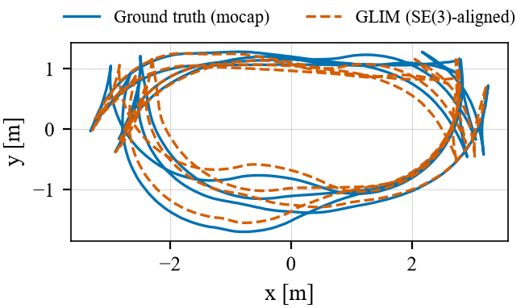
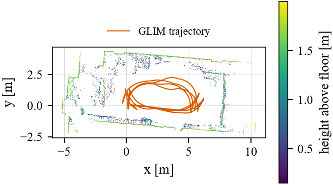
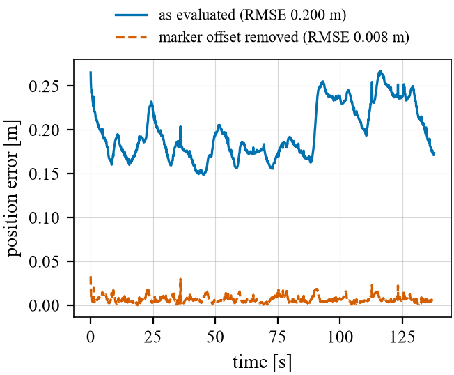
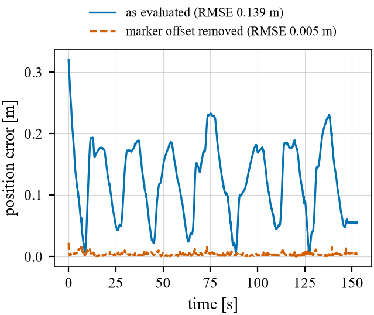
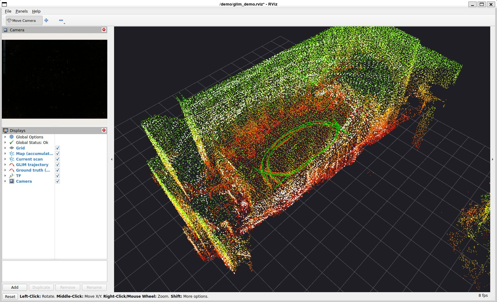
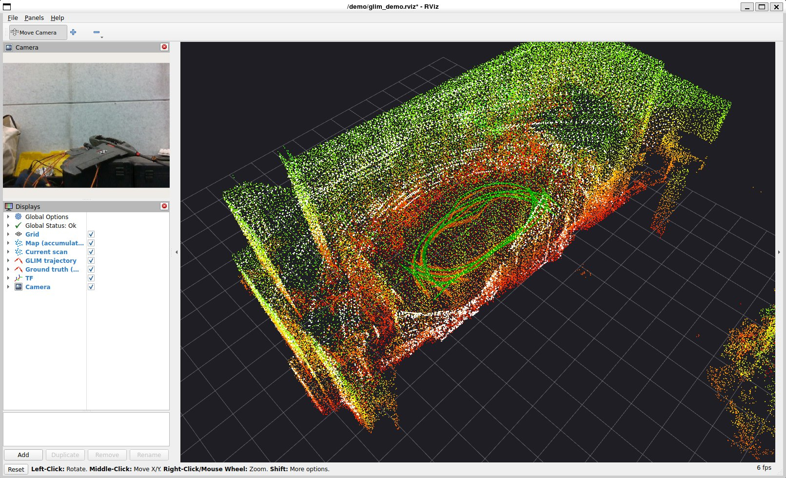

# GLIM: status report after lab session 1

Philip Stix · branch `philip-glim` · 2026-10-08

## Summary

- GLIM runs end to end on M3DGR: M3DGR bag → converter → GLIM (Docker, GPU) → `trajectory_tum.txt` + `map.ply` → `pipeline.evaluate`.
  The lab 1 goal (play the dataset back in ROS and show it in RViz) is done; see [Live demo](#live-demo-rviz).
- **Varying-illu01, 5/5 runs successful.** ATE RMSE (SE(3)) median **0.138 m**, IQR 0.09 mm. The runs are practically deterministic (re-run on 2026-11-26: spread ≤ 0.4 mm, see [Resources](#resources-measured-in-the-container)).
- **Most of this error is not GLIM's error.** The Sim(3) scale is 1.034, although a LiDAR system should have a scale of about 1.
  A constant 0.20 m offset between GLIM's IMU frame and the mocap body frame explains almost all of it: once it is removed, the ATE is 0.004 m and the scale is 1.000.
  The ground-truth frame (`gt_to_base_extrinsic`) has to be resolved for **all** systems before lab 2 (see [Key finding](#key-finding-the-ground-truth-frame)).
- Resources (measured in the container by the pipeline since 2026-11-26): about 1.6 CPU cores on average, ≤ 465 MiB RAM and 217 MiB GPU memory. One run takes 78-88 s for 139-175 s of data.

## Setup

| | |
|---|---|
| System | GLIM (Koide et al., RAS 2024, `koide2024glim`): LiDAR-IMU, GPU, global optimisation over submaps |
| Version | glim `2262aaf`, glim_ros2 `4d4ec52`, image `koide3/glim_ros2:jazzy_cuda13.1@sha256:8e00163c…` |
| Input | MID-360 LiDAR (`/livox/mid360/lidar`, Livox CustomMsg → PointCloud2 with per-point times) + MID-360 IMU |
| Hardware | i7-11370H (8 threads), 31.8 GB RAM, RTX 3050 Ti Laptop 4 GB, Windows 11 + Docker Desktop (WSL2) |
| Parameters | GLIM defaults (GPU variant). Deviations: topics, `acc_scale` 9.80665 (the Livox IMU reports g, which I checked on the bag: \|a\| = 1.0 g at rest), `T_lidar_imu` from M3DGR `calibration.md`, viewers off. All are listed in [`config/systems/glim.yaml`](../../config/systems/glim.yaml). |
| Execution | `glim_rosbag` offline (it throttles itself, so no scan is dropped). Evaluated trajectory: `traj_imu.txt` (IMU frame, with global optimisation) |

## Results: Varying-illu01

Computed with `pipeline.evaluate` (evo, Umeyama SE(3), `t_max_diff` 0.01 s, 1517 matched poses, 99.2 % of the GT duration tracked).

| Run | ATE RMSE [m] | mean | median | max | Sim(3) RMSE [m] | Sim(3) scale | wall time [s] |
|---|---|---|---|---|---|---|---|
| 0 | 0.1384 | 0.1242 | 0.1298 | 0.3192 | 0.1140 | 1.0341 | 67.9 |
| 1 | 0.1386 | 0.1245 | 0.1304 | 0.3204 | 0.1145 | 1.0339 | 76.2 |
| 2 | 0.1385 | 0.1243 | 0.1299 | 0.3193 | 0.1141 | 1.0340 | 71.1 |
| 3 | 0.1385 | 0.1243 | 0.1299 | 0.3194 | 0.1141 | 1.0340 | 69.7 |
| 4 | 0.1384 | 0.1242 | 0.1298 | 0.3192 | 0.1140 | 1.0341 | 69.0 |
| **median / IQR** | **0.1385 / 0.0001** | | | | | | 69.7 |

Supplementary numbers (run 0):
- Path length: GT 72.0 m, GLIM 70.4 m.
- 2D ATE (`--project_to_plane xy`): 0.125 m (`traj_lidar.txt`).
- `traj_lidar.txt` (LiDAR frame): ATE 0.125 m. This differs from `traj_imu.txt` only by the 5 cm LiDAR-IMU lever arm, which is further evidence that the reference frame matters.
- `odom_imu.txt` is identical to `traj_imu.txt`. GLIM built only one submap in this small room, so the global optimisation (and therefore loop closure) did not change anything.

**Resources** (GLIM container, sampled about every 3 s with `docker stats` and `nvidia-smi` over runs 1-4; context only, not for ranking):

| CPU (% of one core) | RAM peak | GPU memory peak | GPU utilisation |
|---|---|---|---|
| mean 193, p95 265, max 273 | 426-441 MiB | 217 MiB | mean 25 %, max 72 % |

Note: `resources.csv` from the pipeline only sees the `docker` CLI process, not GLIM inside the container. Measuring inside the container needs a pipeline change for container-based systems (see the to-do list).





## Results: Dynamic01 and Sha-turn01 (2026-11-26)

Same image (digest), config and evaluation as above; 5/5 runs successful on both sequences.

| Sequence | ATE RMSE median [m] | IQR [m] | max [m] | Sim(3) scale | tracked | wall time median [s] | submaps |
|---|---|---|---|---|---|---|---|
| Varying-illu01 | 0.1385 | 0.0001 | 0.32 | 1.034 | 99.2 % | 69.7 | 1 |
| Dynamic01 | 0.1416 | < 0.0001 | 0.31 | 1.034 | 99.3 % | 89.0 | 1 |
| Sha-turn01 | 0.1999 | < 0.0001 | 0.27 | 1.002 | 99.1 % | 70.8 | 2 |

These are the first runs. All 15 runs were repeated on 2026-11-26 with the container measurement (see [Resources](#resources-measured-in-the-container)). The committed `results/glim` are the repeated runs: median ATE 0.1385 / 0.1417 / 0.1999 m (V / D / S), IQR 0.16 / 0.15 / 0.30 mm. Single poses differ from the first runs by up to 7 mm; the medians agree to 0.1 mm.

Diagnostic lever-arm fit (run 0, same method as below; uses the GT, not a result):

| Sequence | fitted offset in IMU frame [m] | \|l\| [m] | ATE after fit [m] |
|---|---|---|---|
| Varying-illu01 | (-0.138, -0.127, -0.076) | 0.202 | 0.004 |
| Dynamic01 | (-0.142, -0.126, -0.079) | 0.205 | 0.007 |
| Sha-turn01 | (-0.139, -0.129, -0.074) | 0.203 | 0.008 |

- **The offset is a property of the rig, not of the sequence.** It is fitted independently on three sequences and agrees to about 4 mm. This supports the group decision to treat it as a documented limitation (`gt_to_base_extrinsic` identity), and it means the GLIM error proper is below 1 cm on all three sequences.
- **Sha-turn01 has the highest ATE (0.20 m), but not because GLIM is worse there.** After the offset fit, the error is 0.008 m, like on the other sequences. The sharp turns and the changing motion pattern project the constant offset into a larger position error, for example the step at about 90 s in the ATE-over-time figure. The Sim(3) scale is close to 1 here because the offset no longer looks like a radius change on uniform loops.
- **Sha-turn01 is the first sequence with two submaps,** so the global optimisation contributes at least one submap-to-submap factor there. With only one overlap, the effect is still small.
- Path length: Dynamic01 GT 71.1 m / GLIM 69.7 m, Sha-turn01 GT 97.4 m / GLIM 97.4 m.
- Wall time scales with sequence length: about 0.45-0.51 s per second of data on all three sequences (Dynamic01 is the longest at 175 s).

Figures: `fig_trajectory_<seq>.png`, `fig_ate_over_time_<seq>.png`, `fig_map_topdown_<seq>.png`; paper figures `paper/figures/glim_map_<seq>.pdf`.



## Resources (measured in the container)

Until now, `resources.csv` only saw the `docker` CLI process (8 % CPU, 65 MiB), not GLIM. Since 2026-11-26:
- `pipeline/resources.py` can sample a container with `docker stats`, about one sample every 2 s. CPU is given in % of one core, as for the process tree; RAM is the container memory.
- `pipeline/run_all.py` names the container `bearl-<slug>-<seq>-run<k>` when the system config has `docker: true`, and passes that name to the runner (`cfg["container_name"]`).
- `pipeline/runners/glim.py` starts the container under that name.
- I tested it with a load container: two busy loops measure 200 %. GPU memory is still the whole GPU (nvidia-smi).

All 15 runs, RTX 3050 Ti laptop, Docker Desktop (WSL2):

| Sequence | wall time median [s] | real-time factor median (min-max) | CPU mean [% of one core], median (min-max) | RAM peak [MiB] | GPU memory peak [MiB] | samples per run |
|---|---|---|---|---|---|---|
| Varying-illu01 | 78 | 0.51 (0.50-0.59) | 165 (146-167) | ≤ 463 | 217 | 38-44 |
| Dynamic01 | 88 | 0.50 (0.49-0.51) | 165 (163-167) | ≤ 441 | 217 | 42-44 |
| Sha-turn01 | 80 | 0.58 (0.52-0.61) | 150 (147-160) | ≤ 440 | 217 | 35-40 |

Real-time factor = wall time / duration of the data (GT span: 154.1 / 175.2 / 139.0 s). Below 1 means faster than real time: GLIM processes the sequences in about half their duration. The wall time includes the container start and the dump at the end, so GLIM's own processing is somewhat faster than this. Offline mode (`glim_rosbag`) reads as fast as GLIM can process, so this measures throughput and does not show whether GLIM would keep up live. The RViz demo runs GLIM live at 1x (default rate of `run_demo.sh`) and looks smooth. Whether every scan is processed in that mode was not checked.

This agrees with the manual `docker stats` measurement in October (426-441 MiB, 217 MiB GPU). The mean CPU is lower than the 193 % measured then, because the start and end of the container are now included. Wall times on V and S are 11-13 % longer than in the first runs, on D they are unchanged. The extra `docker stats` calls are a possible cause, but this was not checked.

## Map quality (RQ1)

`pipeline/map_eval.py` from `main` against the LiDAR pseudo-ground-truth map (`pipeline/reference_map.py`, built
locally for all three sequences), run 0, region `common`, after trajectory alignment + ICP (accepted on all three).
All GLIM rows: [`map_metrics_glim.csv`](map_metrics_glim.csv).

| Sequence | F-score 10 cm | F-score 5 cm | accuracy median | completeness median | GLIM points / reference points |
|---|---|---|---|---|---|
| Dynamic01 | 0.918 | 0.566 | 0.010 m | 0.057 m | 13 779 / 1 281 386 |
| Sha-turn01 | 0.962 | 0.668 | 0.010 m | 0.049 m | 18 942 / 1 303 922 |
| Varying-illu01 | 0.934 | 0.586 | 0.010 m | 0.055 m | 13 647 / 1 239 397 |

For comparison, FAST-LIO2 (same evaluation, on `main`) scores 0.89 / 0.99 / 0.99 at 10 cm, and VGGT-Long and MASt3R-SLAM score 0.65-0.78 on D and S.

- **What GLIM maps is right:** accuracy is 1 cm, the level of the LiDAR noise.
- **Lower completeness comes from GLIM's export, not from its estimate.** The exported `map.ply` is a strongly thinned submap (about 1 % of the reference's points). That is why F-score at 5 cm is low. MPV/MME (wall noise) cannot be computed on it either: too few neighbours, empty on D and V.
- **ICP translation is 0.38 m, the same as for FAST-LIO2.** ICP removes the mocap-body offset as intended (see below).
### Dense map: all scans on GLIM's trajectory

[`tools/glim_dense_map.py`](../../tools/glim_dense_map.py) places every MID-360 scan with GLIM's own LiDAR-frame trajectory (`traj_lidar.txt`, with global optimisation). Each point gets the pose interpolated at its own time. The filters are the same as for the reference (noise tag, 0.5-12 m, 2 cm voxels), but there is no people filter, because that belongs to the reference, not to an estimate. No ground truth is used. Output: `results/glim/<seq>/run_00/map.dense.ply` (git-ignored). All rows: [`map_metrics_glim_dense.csv`](map_metrics_glim_dense.csv).

| Sequence | F-score 10 cm (dense / thinned) | precision 10 cm | recall 10 cm | accuracy median | MPV est / ref [m²] | FAST-LIO2 F-score 10 cm |
|---|---|---|---|---|---|---|
| Dynamic01 | **0.796** / 0.918 | 0.662 | 1.000 | 0.014 m | 8e-4 / 5e-4 | 0.892 |
| Sha-turn01 | **0.987** / 0.962 | 0.975 | 1.000 | 0.010 m | 5e-4 / 5e-4 | 0.990 |
| Varying-illu01 | **0.986** / 0.934 | 0.972 | 1.000 | 0.010 m | 5e-4 / 5e-4 | 0.990 |

- **On S and V, GLIM's dense map is as good as FAST-LIO2's** (0.99): recall is 1.0, and the wall noise (MPV) is at the level of the reference, which is set by the LiDAR's own noise.
- **On D, precision drops to 0.66 because of the people walking through the scene.** The mean accuracy is 0.27 m against a median of 1.4 cm, so the drop comes from a few distant points, not from a systematic error. The reference removes people with a static filter; an estimate keeps them. FAST-LIO2 shows the same effect, but less strongly (precision 0.81), probably because its map does not keep every scan. With the thinned map the effect is smaller, because it hardly contains any people.
- For the paper, the dense map is the fairer comparison with FAST-LIO2, because both place all scans on their own trajectory. The thinned map shows what GLIM itself exports.

## Light on/off: GLIM as the control (RQ2/RQ3)

Same split as `notebooks/story.py` (`dark_lit_rmse` on `main`): a pose counts as dark if more than 80 % of the
interpolated camera frame's pixels are below grey value 20, with the alignment and association of `tools/build_cache.py`.

| Varying-illu01 (5 runs, median) | lit (816 poses) | dark (701 poses) |
|---|---|---|
| ATE RMSE as evaluated | 0.123 m | 0.155 m |
| GT frame corrected with the rig calibration + time offset (no fit, [`gt_frame_check.py`](gt_frame_check.py)) | 0.0053 m | 0.0041 m |
| after removing the GT-fitted body offset (run 0, diagnostic) | 0.0047 m | 0.0039 m |

Recomputed on the repeated runs (2026-11-26); the raw numbers are unchanged to 0.1 mm.

- **Darkness does not affect GLIM.** The 3 cm higher raw error in dark frames comes entirely from the mocap-body offset. Its contribution depends on where the robot is and which way it faces, and the dark phases happen to fall on different parts of the loops. The turning rate is the same in both (median 10.2 vs. 10.6 deg/s).
- **No self-reported failure:** the GLIM logs contain only two start-up warnings (`playback_speed` not set, default used), on all three sequences. Tracking is continuous: 99.2 % of the GT duration is matched.
- **Caveat for the group:** the raw dark/lit split of every system contains this offset effect, about 3 cm on V for GLIM. The size and sign differ for other sensor frames. That is negligible next to VGGT-Long's 2.48 / 2.17 m, but it matters for any system whose dark/lit difference is only a few centimetres.

## Key finding: the ground-truth frame

The ATE error oscillates with every loop the robot drives (blue curve). This is the signature of a **constant lever arm** between the tracked frame (GLIM: MID-360 IMU) and the mocap rigid body (`/vrpn_client_node/UGV/pose`).
The SE(3) alignment cannot absorb this offset because it rotates with the robot. On circles it shows up as a different radius, which explains why the Sim(3) scale is 1.034 instead of 1.

Diagnostic: I fitted a constant offset in the IMU frame together with the SE(3) alignment (see [`make_figures.py`](make_figures.py)).
- Fitted offset: **l = (-0.138, -0.127, -0.076) m, |l| = 0.20 m**.
- Remaining ATE: **0.004 m**; Sim(3) scale: **1.000**.



**Do not use the 0.004 m in the paper.** The offset was estimated from the GT itself, so it is optimistic. The finding is that **our current numbers mostly measure the frame offset, not the SLAM error.** This affects every system, including camera-based ones (camera ≠ mocap body).
M3DGR `calibration.md` gives the extrinsics between the sensors, but not to the mocap body. The `gt_to_base_extrinsic` entry in `config/sequences.yaml` is still TODO.

**Cross-check against the rig calibration (2026-11-26, [`lever_arm_check.py`](lever_arm_check.py)).** The reference map on `main` estimates `body_T_base` from map consistency alone (no SLAM involved). Chained with the calibration (`base_T_lidar`) and GLIM's `T_lidar_imu`, it predicts where GLIM's IMU sits in the mocap body frame. The fit above gives the same position from GLIM's trajectory alone:

| | IMU origin in body frame x [m] | y [m] | difference to predicted |
|---|---|---|---|
| predicted (rig calibration) | -0.150 | -0.132 | |
| fitted, Dynamic01 | -0.158 | -0.131 | 8 mm |
| fitted, Sha-turn01 | -0.153 | -0.134 | 3 mm |
| fitted, Varying-illu01 | -0.154 | -0.132 | 4 mm |

Height is unobservable for planar motion in both, so only x and y are compared. The two independent estimates agree to 3-8 mm. This confirms both the reference-map calibration and the interpretation of GLIM's offset. It also means the group could correct the GT frame for every system with `body_T_base` instead of documenting the offset as a limitation, which should bring GLIM's ATE from 0.14 m close to the < 1 cm left after the fit (not computed yet). That decision belongs to the group (it changes all ATE numbers).

**What the correction would do for GLIM** ([`gt_frame_check.py`](gt_frame_check.py), all 5 runs per sequence). GLIM's IMU poses are moved into the mocap body frame with the calibration chain above. Nothing is fitted on the GT. The evaluation is then the usual SE(3) ATE. Optionally, the LiDAR-mocap time offset of the reference map (`reference_map.time_offset_s`, 7-18 ms) is applied as well.

| ATE RMSE median [m] | as evaluated | corrected frame | corrected frame + time offset |
|---|---|---|---|
| Dynamic01 | 0.1417 | 0.0104 | **0.0077** |
| Sha-turn01 | 0.1999 | 0.0122 | **0.0085** |
| Varying-illu01 | 0.1385 | 0.0071 | **0.0048** |

GLIM's ATE drops from 14-20 cm to 5-9 mm, which is close to the < 1 cm left by the GT-fitted offset. That is the size of the LiDAR noise and of the mocap-sensor synchronisation. The time offset accounts for another 2-4 mm. For the camera systems, the same chain would need `base_T_camera` instead of `base_T_lidar` (all in `calibration.md`).

Options for the group, to decide in lab 2:
1. Find the mocap-body ↔ sensor transform: M3DGR README/issues, the paper, or ask the authors. This is the clean solution.
2. If it is not available, evaluate every system in **one** common sensor frame and convert each system's trajectory into it with the known `calibration.md` extrinsics. Fit the remaining body offset **once** on one reference system and document it as a limitation. Not ideal, but the same for everyone.
3. In any case, report the Sim(3) scale of metric systems as a check: ≈ 1 means the frame is right.

## Live demo (RViz)

`bash docker/glim/demo/run_demo.sh` plays the bag back and runs GLIM live. RViz shows:
- the map accumulated from the aligned scans, coloured by height,
- the current scan in white,
- the GLIM trajectory in orange and the mocap ground truth in green,
- the camera image.

Setup and details are in [`docker/glim/README.md`](../../docker/glim/README.md).

Lights off in *Varying-illu01*: the camera image is black, but the LiDAR map keeps growing without disruption. This matters for the modality discussion (LiDAR is independent of illumination, cameras are not).



End of the sequence (map complete, the GLIM trajectory lies under the GT):



## Observations for the discussion (paper)

- **Determinism:** 5 runs agree to < 0.4 mm ATE (single poses to a few mm). GLIM is not bit-exact, probably because of multithreading, but practically deterministic, so N = 5 runs say little about variance. Report it honestly instead of adding more runs.
- **Global optimisation not exercised:** one submap means no submap-to-submap factors and no loop closure effect. `Dynamic01` and `Dark03` may differ, so check whether more submaps appear there.
- **Darkness:** irrelevant for GLIM (expected), and a contrast to the camera systems.
- **Map figure:** GLIM's own map is a single downsampled submap (31.5 k points). The top-view slice shows the room outline well. For a 3D figure use the RViz screenshot or the offline viewer.

## To do for lab 2

Group:
- [ ] Decide on the GT frame (see above) and fill `gt_to_base_extrinsic`. **Blocking for all ATE numbers.**
- [x] Resources for Docker-based systems: implemented on this branch (`docker: true` in the system config, see [Resources](#resources-measured-in-the-container)). Other container systems can switch it on by naming their container `cfg["container_name"]`.
- [ ] Do not commit `results/metrics.csv` / `summary.csv` per branch (merge conflicts). Generate them once on `main`.

Me (GLIM):
- [x] ~~Dynamic01 and Dark03~~ Dynamic01 and Sha-turn01 (the evaluated set changed on `main`), 5 runs each (2026-11-26).
- [x] Trajectory frame: the group decided on identity (`config/sequences.yaml`), so `traj_imu.txt` stays.
- [x] `paper/members/stix.tex`: SOTA, methods, results (2026-11-26). It is a new file on both branches, so the merge with `main` gives a trivial add/add conflict: keep this version. `koide2024glim` comes with this branch's `references.bib`.
- [x] Map figures for the paper: `paper/figures/glim_map_<seq>.pdf` for all three sequences.

## Draft: theory paragraph (for `paper/main.tex`)

> GLIM [koide2024glim] is a tightly coupled range-inertial localization and mapping framework whose scan-matching (VGICP) cost factors are evaluated on the GPU. Its odometry combines fixed-lag smoothing with IMU preintegration factors and matches each new frame against a set of spatially distributed keyframes as well as the most recent frames, which makes it robust to a few seconds of completely degenerate range data. Frames leaving the odometry window are passed to a local mapping module that merges them into submaps, refining each submap through batch factor-graph optimisation over all frame pairs. A global mapping module then optimises the submap poses by directly minimising the registration errors between every pair of sufficiently overlapping submaps, so that loops are closed implicitly without explicit place recognition. Because it is a metric LiDAR-inertial system, the trajectory is evaluated with SE(3) alignment.

Checked against arXiv 2407.10344 on 2026-11-26 (Sec. III-C VGICP; IV-B odometry, keyframes and last frames, iSAM2; V-A local mapping, batch LM optimisation over all frame pairs; V-B global mapping, overlap > ~5 %, implicit loop closure). Sections VI-D to VIII were not checked. The last sentence is our evaluation choice, not a claim from the paper. It is a summary, not a quotation.

## Reproduce

```bash
python tools/glim_prepare_bag.py --bag data/M3DGR/Varying-illu01.bag --sequence Varying-illu01
for k in 0 1 2 3 4; do python -m pipeline.run_all --system glim --sequence Varying-illu01 --run $k; done
python -m pipeline.evaluate
python docs/glim/make_figures.py
```
